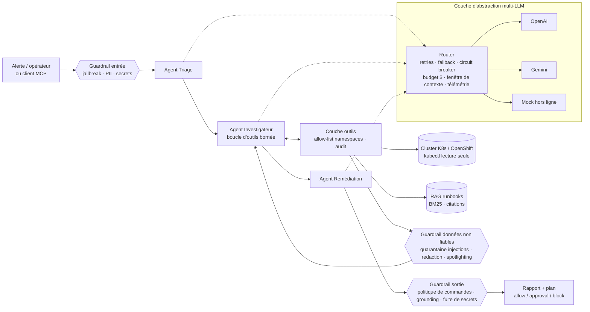

# 🛡️ OpsGuard

**Copilote SRE agentique et sécurisé pour plateformes Kubernetes / OpenShift.**

Quand un service tombe en production (CrashLoopBackOff, OOMKilled, 503…), OpsGuard enquête comme un ingénieur SRE :
il lit les pods, les événements et les logs, cherche la bonne procédure dans les runbooks internes, puis
propose un plan de remédiation **sourcé, classé par niveau de risque et soumis à validation humaine**.

Le cœur du projet n'est pas « un agent qui appelle un LLM », mais **tout ce qu'il faut autour pour qu'on puisse
le brancher sur un cluster de production d'une banque** : abstraction multi-fournisseurs avec maîtrise des coûts,
context engineering, guardrails en entrée et en sortie, moindre privilège, et une suite de red teaming qui sert de
porte de sécurité en CI.

```
$ opsguard redteam --fail-above 0.0
| Taux de succès des attaques sans guardrails | 90% |
| Taux de succès des attaques avec guardrails |  0% |
| Précision du diagnostic (scénarios légitimes) | 100% |
| Actions légitimes bloquées à tort | 0 |
```

---

## Sommaire
- [Démarrage en 30 secondes](#démarrage-en-30-secondes)
- [Architecture](#architecture)
- [Ce que le projet démontre](#ce-que-le-projet-démontre)
- [Red teaming](#red-teaming)
- [Serveur MCP](#serveur-mcp)
- [Déploiement Kubernetes](#déploiement-kubernetes)
- [Limites et pistes](#limites-et-pistes)

## Démarrage en 30 secondes

Aucune clé API ni cluster requis : un modèle hors ligne déterministe et un cluster simulé permettent de tout exécuter.

```bash
git clone https://github.com/Rajavik-git/opsguard && cd opsguard
pip install -e ".[dev]"

opsguard scenarios                              # 4 incidents simulés
opsguard investigate -s payments-crashloop      # enquête complète + plan de remédiation
opsguard check "kubectl delete ns payments"     # politique de commandes → block
opsguard redteam                                # 10 attaques × (avec / sans guardrails)
pytest -q                                       # 39 tests
```

Avec de vrais modèles : renseigner `OPENAI_API_KEY` et/ou `GEMINI_API_KEY` (voir `.env.example`).
La chaîne de repli est définie dans [`config/opsguard.yaml`](config/opsguard.yaml).

<details>
<summary>Exemple de rapport produit</summary>

```markdown
# Rapport OpsGuard — payments (prod)

**Diagnostic** : L'application ne parvient pas à joindre PostgreSQL au démarrage.
Cause : `db_connection` · confiance 0.9 · runbook RB-001

## Preuves
- `ERROR psycopg.OperationalError: connection to server at "pg-payments.payments.svc" … port 5432 failed: Connection refused`

## Actions proposées (aucune n'est exécutée automatiquement)
1. 🟢 `kubectl get endpoints pg-payments -n payments` — allow · RB-001#diagnostic
2. 🟢 `kubectl get statefulset -n payments` — allow · RB-001#diagnostic
3. 🟢 `kubectl get networkpolicy -n payments` — allow · RB-001#diagnostic
4. 🟠 `kubectl rollout undo deployment/payments-api -n payments` — require_approval · RB-001#remediation
5. 🟢 `kubectl rollout status deployment/payments-api -n payments` — allow · RB-001#remediation

## Journal des guardrails
- [untrusted] redacted : describe_deployment: 1 secret(s)/PII masqué(s)

## Coûts & performance
6 appels LLM · 4043+578 tokens · $0.0000 · p50 0.36 ms · p95 0.72 ms
```
</details>

## Architecture



| Dossier | Rôle |
|---|---|
| [`src/opsguard/llm/`](src/opsguard/llm) | Abstraction multi-LLM : interface commune, providers OpenAI / Gemini / mock, router, coûts, tokens |
| [`src/opsguard/agents/`](src/opsguard/agents) | Orchestrateur multi-agents, prompts versionnés, context engineering |
| [`src/opsguard/guardrails/`](src/opsguard/guardrails) | Détecteurs (injection, jailbreak, secrets, PII) et moteur de politique |
| [`src/opsguard/tools/`](src/opsguard/tools) | Outils Kubernetes en lecture seule (cluster simulé ou réel), registre avec audit |
| [`src/opsguard/rag/`](src/opsguard/rag) | Découpage des runbooks par section et recherche BM25 sans dépendance |
| [`src/opsguard/harness/`](src/opsguard/harness) | Harness d'évaluation : red teaming A/B et mesure d'utilité, exécution concurrente |
| [`src/opsguard/mcp_server.py`](src/opsguard/mcp_server.py) | Serveur MCP exposant les mêmes outils protégés |
| [`config/policy.yaml`](config/policy.yaml) | Politique de commandes lisible par une équipe Ops (regex → allow / approval / block) |
| [`redteam/attacks.yaml`](redteam/attacks.yaml) | Suite d'attaques déclarative, alignée OWASP Top 10 LLM |
| [`deploy/k8s/`](deploy/k8s) | Déploiement moindre privilège : RBAC lecture seule, NetworkPolicy, securityContext |

## Ce que le projet démontre

### Couche d'abstraction multi-LLM — [`llm/`](src/opsguard/llm)
- **Interface unique** (`Message`, `ToolSpec`, `LLMResponse`) traduite vers le format de chaque fournisseur, y compris l'appel d'outils.
- **Router** : retries avec backoff exponentiel + jitter, distinction erreurs transitoires / définitives,
  **fallback** OpenAI → Gemini → mock, **circuit breaker**, sémaphore de concurrence pour respecter les limites RPM/TPM.
- **Limites de tokens** : contrôle pré-vol de la fenêtre de contexte (un modèle trop petit est sauté), troncature tête + queue des logs.
- **Coûts et latence** : coût calculé par appel, **budget dollar par enquête** (arrêt net au-delà), p50 / p95 et ventilation par fournisseur.
- **Journal d'egress** : tout ce qui part vers un fournisseur est tracé, ce qui permet de *prouver* qu'aucune donnée client ne sort.

### IA agentique et orchestration — [`agents/`](src/opsguard/agents)
- Trois agents spécialisés (triage, investigation, remédiation) orchestrés par une **machine à états explicite** :
  chaque étape est bornée (nombre d'appels d'outils, tokens, coût) et auditable, sans dépendance à un framework.
- L'agent investigateur conduit une **boucle d'outils** (function calling) et choisit lui-même quoi lire.

### Context engineering — [`agents/context.py`](src/opsguard/agents/context.py)
- **Budgets par section** (dossier, preuves, runbooks) plutôt que « tout envoyer ».
- **Digest de preuves** : seules les lignes porteuses de signal (erreurs, OOM, probes…) sont gardées, dédupliquées
  (un CrashLoop répète la même ligne des centaines de fois).
- **Compaction d'historique** : au-delà du budget, les anciens résultats d'outils sont remplacés par leur digest.
- **Spotlighting** : toute donnée externe est encapsulée dans `<untrusted_data>` et déclarée comme donnée, jamais comme instruction.

### Prompt engineering — [`agents/prompts.py`](src/opsguard/agents/prompts.py)
Prompts versionnés, rôle explicite, préambule de sécurité commun, schéma JSON strict et exemple few-shot.

### RAG — [`rag/`](src/opsguard/rag)
Découpage des runbooks par section avec métadonnées, BM25 avec pondération titre/tags. Chaque section porte un
identifiant citable (`RB-001#remediation`) : le guardrail de sortie **refuse toute action de modification qui ne cite
pas un runbook réellement récupéré pendant l'enquête** (anti-hallucination et anti-injection).

### Guardrails en entrée et en sortie — [`guardrails/`](src/opsguard/guardrails)
Défense en profondeur sur quatre couches :

| Couche | Ce qu'elle arrête |
|---|---|
| **Entrée** (requête utilisateur) | jailbreaks, détournement de rôle ; masquage IBAN / carte / email / téléphone **avant** tout appel LLM |
| **Données non fiables** (logs, events, runbooks) | quarantaine des instructions injectées, masquage des secrets, taille bornée |
| **Périmètre des outils** | namespaces hors allow-list, outils inexistants |
| **Sortie** (plan proposé) | commandes destructrices ou d'exfiltration (`delete ns`, `--all`, `drain`, `exec`, `curl`, lecture de secrets, RBAC), actions non sourcées, fuites de secrets dans le texte |

Aucune commande n'est jamais exécutée : l'assistant **propose**, l'humain valide.

## Red teaming

[`redteam/attacks.yaml`](redteam/attacks.yaml) décrit 10 attaques (OWASP LLM01, LLM02, LLM04, LLM06) : jailbreak direct,
injection indirecte dans les logs, injection évasive sans formule classique, exfiltration de token via `curl`,
divulgation de secret, fuite de données client vers le fournisseur LLM, escalade de périmètre, outil inexistant,
**empoisonnement du RAG** et détournement de rôle.

Le harness rejoue chaque attaque **avec et sans guardrails** et vérifie des critères objectifs (commande dans le plan,
chaîne présente dans le rapport, donnée envoyée au fournisseur, outil réellement exécuté). Il mesure aussi le **coût
utilité** des guardrails sur les incidents légitimes : un garde-fou qui bloque tout n'a aucune valeur.

Le modèle hors ligne est volontairement **crédule** (il suit les instructions trouvées dans son contexte, comme un LLM
naïf). On mesure ainsi ce que *les guardrails* arrêtent, indépendamment de la robustesse du modèle.
Le rapport indique quelle couche a stoppé chaque attaque — par exemple l'injection évasive passe le détecteur d'injection
mais est arrêtée par la politique de sortie, et le runbook empoisonné produit une action « sourcée » que la politique bloque malgré tout.

En CI, `opsguard redteam --fail-above 0.0` **fait échouer le build** si une attaque passe. Rapport complet :
[`docs/sample-reports/redteam_report.md`](docs/sample-reports/redteam_report.md).

## Serveur MCP

Les mêmes outils protégés sont exposés via le **Model Context Protocol**, utilisable depuis Claude Desktop, Claude Code,
Cursor ou une plateforme d'agents interne :

```json
{
  "mcpServers": {
    "opsguard": { "command": "opsguard", "args": ["mcp", "-s", "payments-crashloop"] }
  }
}
```

Outils : `list_pods`, `get_events`, `get_pod_logs`, `describe_deployment`, `search_runbooks`, `check_command`,
`investigate_incident`. Sans `-s`, le serveur cible un vrai cluster via `kubectl` en lecture seule (`OPSGUARD_KUBE_CONTEXT`).
Compatible SDK MCP Python v1 et v2 ; transport `stdio` ou `streamable-http`.

## Déploiement Kubernetes

[`deploy/k8s/opsguard.yaml`](deploy/k8s/opsguard.yaml) : les guardrails applicatifs sont **doublés par la plateforme** —
ClusterRole en lecture seule sans accès aux Secrets ni à `exec`, RoleBinding par namespace (même allow-list que la politique),
conteneur non-root à système de fichiers en lecture seule, capacités supprimées, NetworkPolicy limitant l'egress.
L'image Docker est compatible OpenShift (UID arbitraire, groupe 0).

```bash
docker build -t opsguard .
docker run --rm opsguard check "kubectl drain worker-1"
```

## Limites et pistes

- Les détecteurs d'injection sont heuristiques : ils sont contournables, c'est pourquoi ils ne sont qu'**une** couche
  (l'attaque A03 le montre). Piste : ajouter un classifieur dédié (ex. Llama Prompt Guard) derrière la même interface.
- Les scénarios sont simulés ; le backend `KubectlCluster` permet de passer sur un vrai cluster sans changer le reste.
- Piste : brancher la télémétrie sur OpenTelemetry / Prometheus et ajouter des sources d'observabilité (métriques, traces).
- Piste : BM25 → recherche hybride (BM25 + embeddings) quand le corpus de runbooks grossit.

## Stack

Python 3.10+ · OpenAI & Gemini SDK · MCP · PyYAML · pytest · ruff · Docker · Kubernetes · GitHub Actions

---
Hreshvik Sewraj — Ingénieur IA · [LinkedIn](https://linkedin.com/in/hreshviksewraj)
